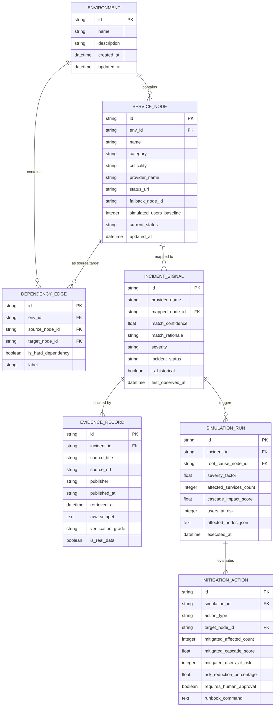

# SentinelTwin — Database Schema & Data Models (DATABASE)

**Document ID:** DB-001  
**Project:** SentinelTwin  
**Storage Engine:** SQLite 3 (via `aiosqlite` async pool)  
**Version:** 1.0.0  

---

## 1. Database Architecture & Design Rationale

For a 24-hour hackathon MVP and local incident decision-support workstation, SQLite is selected for:
1. **Zero External Daemon Dependencies:** No Docker or PostgreSQL host required.
2. **ACID Transactional Guarantees:** Reliable state persistence across investigation runs and simulation sessions.
3. **Portability:** Entire system database resides in a single file (`sentineltwin.db`), allowing rapid snapshotting, seeding, and demo environment resets.
4. **Sub-Millisecond Read Latency:** In-memory or local SSD caching delivers instant dashboard queries ($< 5\text{ ms}$).

---

## 2. Entity-Relationship (ER) Diagram



---

## 3. SQL DDL & Schema Definitions

```sql
-- Enable foreign key constraint enforcement in SQLite
PRAGMA foreign_keys = ON;

-- 1. Environments Table
CREATE TABLE IF NOT EXISTS environments (
    id TEXT PRIMARY KEY,
    name TEXT NOT NULL,
    description TEXT,
    created_at TIMESTAMP DEFAULT CURRENT_TIMESTAMP,
    updated_at TIMESTAMP DEFAULT CURRENT_TIMESTAMP
);

-- 2. Service Nodes Table
CREATE TABLE IF NOT EXISTS service_nodes (
    id TEXT PRIMARY KEY,
    env_id TEXT NOT NULL,
    name TEXT NOT NULL,
    category TEXT NOT NULL CHECK (category IN (
        'PAYMENT_GATEWAY', 'CLOUD_COMPUTE', 'DNS_ROUTER', 'AUTH_PROVIDER',
        'DATABASE', 'API_BACKEND', 'FRONTEND_CLIENT', 'NOTIFICATION_SVC'
    )),
    criticality TEXT NOT NULL CHECK (criticality IN (
        'MISSION_CRITICAL', 'HIGH', 'MEDIUM', 'LOW'
    )),
    provider_name TEXT NOT NULL,
    status_url TEXT,
    fallback_node_id TEXT,
    simulated_users_baseline INTEGER NOT NULL DEFAULT 10000,
    current_status TEXT NOT NULL DEFAULT 'HEALTHY' CHECK (current_status IN (
        'HEALTHY', 'DEGRADED', 'FAILED', 'UNKNOWN'
    )),
    metadata_json TEXT DEFAULT '{}',
    updated_at TIMESTAMP DEFAULT CURRENT_TIMESTAMP,
    FOREIGN KEY (env_id) REFERENCES environments(id) ON DELETE CASCADE,
    FOREIGN KEY (fallback_node_id) REFERENCES service_nodes(id) ON DELETE SET NULL
);

-- 3. Dependency Edges Table
CREATE TABLE IF NOT EXISTS dependency_edges (
    id TEXT PRIMARY KEY,
    env_id TEXT NOT NULL,
    source_node_id TEXT NOT NULL,
    target_node_id TEXT NOT NULL,
    is_hard_dependency BOOLEAN NOT NULL DEFAULT 1,
    label TEXT,
    FOREIGN KEY (env_id) REFERENCES environments(id) ON DELETE CASCADE,
    FOREIGN KEY (source_node_id) REFERENCES service_nodes(id) ON DELETE CASCADE,
    FOREIGN KEY (target_node_id) REFERENCES service_nodes(id) ON DELETE CASCADE,
    UNIQUE(source_node_id, target_node_id)
);

-- 4. Ingested Incident Signals Table
CREATE TABLE IF NOT EXISTS incident_signals (
    id TEXT PRIMARY KEY,
    provider_name TEXT NOT NULL,
    mapped_node_id TEXT,
    match_confidence REAL NOT NULL DEFAULT 0.0,
    match_rationale TEXT,
    summary TEXT NOT NULL,
    severity TEXT NOT NULL DEFAULT 'MAJOR',
    incident_status TEXT NOT NULL DEFAULT 'INVESTIGATING',
    is_historical BOOLEAN NOT NULL DEFAULT 0,
    first_observed_at TIMESTAMP DEFAULT CURRENT_TIMESTAMP,
    FOREIGN KEY (mapped_node_id) REFERENCES service_nodes(id) ON DELETE SET NULL
);

-- 5. Verified Evidence Records Table
CREATE TABLE IF NOT EXISTS evidence_records (
    id TEXT PRIMARY KEY,
    incident_id TEXT NOT NULL,
    source_title TEXT NOT NULL,
    source_url TEXT NOT NULL,
    publisher TEXT NOT NULL,
    published_at TEXT,
    retrieved_at TIMESTAMP DEFAULT CURRENT_TIMESTAMP,
    raw_snippet TEXT NOT NULL,
    signal_type TEXT NOT NULL,
    verification_grade TEXT NOT NULL CHECK (verification_grade IN (
        'OFFICIAL_CONFIRMED', 'NEWS_CORROBORATED', 'UNVERIFIED_EARLY_WARNING',
        'REPLAY_HISTORICAL', 'FIXTURE_FALLBACK'
    )),
    is_real_data BOOLEAN NOT NULL DEFAULT 1,
    FOREIGN KEY (incident_id) REFERENCES incident_signals(id) ON DELETE CASCADE
);

-- 6. Simulation Runs & History Table
CREATE TABLE IF NOT EXISTS simulation_runs (
    id TEXT PRIMARY KEY,
    incident_id TEXT,
    root_cause_node_id TEXT NOT NULL,
    severity_factor REAL NOT NULL DEFAULT 1.0,
    affected_services_count INTEGER NOT NULL,
    cascade_impact_score REAL NOT NULL,
    users_at_risk INTEGER NOT NULL,
    affected_nodes_json TEXT NOT NULL,
    executed_at TIMESTAMP DEFAULT CURRENT_TIMESTAMP,
    FOREIGN KEY (incident_id) REFERENCES incident_signals(id) ON DELETE SET NULL,
    FOREIGN KEY (root_cause_node_id) REFERENCES service_nodes(id) ON DELETE CASCADE
);

-- 7. Mitigation Evaluations Table
CREATE TABLE IF NOT EXISTS mitigation_actions (
    id TEXT PRIMARY KEY,
    simulation_id TEXT NOT NULL,
    action_type TEXT NOT NULL,
    target_node_id TEXT NOT NULL,
    mitigated_affected_count INTEGER NOT NULL,
    mitigated_cascade_score REAL NOT NULL,
    mitigated_users_at_risk INTEGER NOT NULL,
    risk_reduction_percentage REAL NOT NULL,
    requires_human_approval BOOLEAN NOT NULL DEFAULT 1,
    runbook_command TEXT NOT NULL,
    FOREIGN KEY (simulation_id) REFERENCES simulation_runs(id) ON DELETE CASCADE,
    FOREIGN KEY (target_node_id) REFERENCES service_nodes(id) ON DELETE CASCADE
);
```

---

## 4. Query Indexes & Performance Tuning

```sql
-- Indexes for rapid lookup during graph construction and dashboard load
CREATE INDEX IF NOT EXISTS idx_nodes_env ON service_nodes(env_id);
CREATE INDEX IF NOT EXISTS idx_edges_env ON dependency_edges(env_id);
CREATE INDEX IF NOT EXISTS idx_edges_source ON dependency_edges(source_node_id);
CREATE INDEX IF NOT EXISTS idx_edges_target ON dependency_edges(target_node_id);
CREATE INDEX IF NOT EXISTS idx_incidents_mapped ON incident_signals(mapped_node_id);
CREATE INDEX IF NOT EXISTS idx_evidence_incident ON evidence_records(incident_id);
CREATE INDEX IF NOT EXISTS idx_sim_root_cause ON simulation_runs(root_cause_node_id);
```

---

## 5. Seed Data Reference: `PayPulse Fintech Stack`

The database initializes with the 12-node PayPulse reference architecture:

| Node ID | Service Name | Category | Criticality | Baseline Users | Fallback Node |
| :--- | :--- | :--- | :--- | :--- | :--- |
| `srv-stripe-primary` | Stripe Payment Gateway | `PAYMENT_GATEWAY` | `MISSION_CRITICAL` | 25,000 | `srv-razorpay-backup` |
| `srv-razorpay-backup` | Razorpay Backup Gateway | `PAYMENT_GATEWAY` | `HIGH` | 0 (Standby) | NULL |
| `srv-checkout-svc` | Checkout Microservice | `API_BACKEND` | `MISSION_CRITICAL` | 22,000 | NULL |
| `srv-order-processing`| Order Engine & Webhooks | `API_BACKEND` | `HIGH` | 18,000 | NULL |
| `srv-subscription-worker`| Recurring Billing Worker | `API_BACKEND` | `MEDIUM` | 12,000 | NULL |
| `srv-customer-portal` | Web & Mobile Checkout UI | `FRONTEND_CLIENT` | `HIGH` | 25,000 | NULL |
| `srv-auth0-idp` | Auth0 Authentication | `AUTH_PROVIDER` | `MISSION_CRITICAL` | 30,000 | NULL |
| `srv-cloudflare-dns` | Cloudflare Edge DNS & CDN | `DNS_ROUTER` | `MISSION_CRITICAL` | 35,000 | NULL |
| `srv-aws-compute` | AWS EKS Main Cluster | `CLOUD_COMPUTE` | `MISSION_CRITICAL` | 35,000 | NULL |
| `srv-postgres-core` | Aurora PostgreSQL Primary | `DATABASE` | `MISSION_CRITICAL` | 35,000 | NULL |
| `srv-redis-cache` | Redis Session Cache | `DATABASE` | `MEDIUM` | 30,000 | NULL |
| `srv-sendgrid-mail` | SendGrid Email API | `NOTIFICATION_SVC` | `LOW` | 5,000 | NULL |
