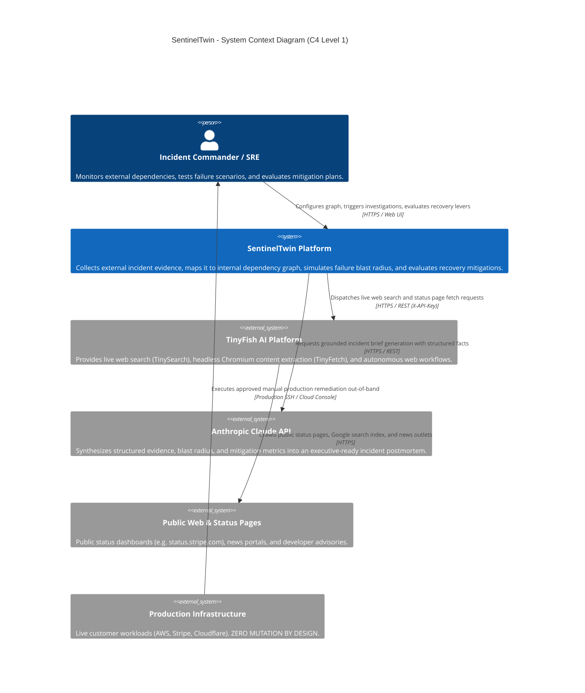
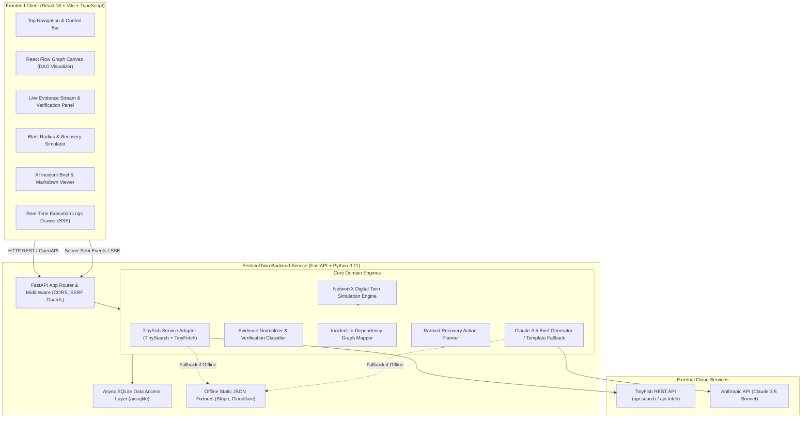
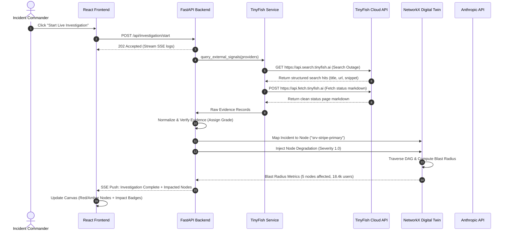
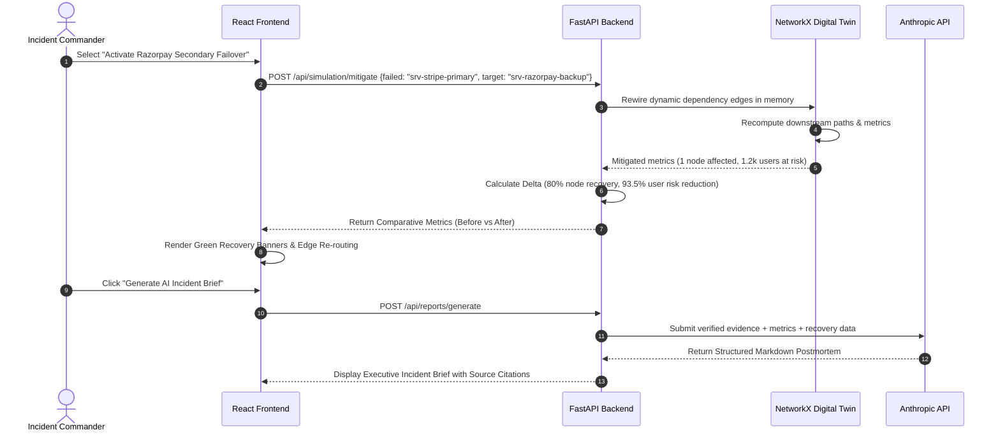

# SentinelTwin — High-Level Design (HLD)

**Document ID:** HLD-001  
**Project:** SentinelTwin  
**Version:** 1.0.0  
**Target Window:** 24-Hour Implementation Window  

---

## 1. System Context Diagram (C4 Level 1)

SentinelTwin operates as an external intelligence, simulation, and decision-support workstation for incident response and infrastructure teams. It interfaces exclusively outwards to web intelligence and AI providers, without inbound or outbound mutation vectors into the customer's production cloud infrastructure.

---

## 2. Container Architecture Diagram (C4 Level 2)

SentinelTwin is structured as a decoupled client-server architecture designed for rapid local deployment or containerized single-host execution.

---

## 3. High-Level Component Interactions

### 3.1 Investigation & Failure Mapping Flow

### 3.2 Recovery Simulation & Before-and-After Mitigation Flow

---

## 4. Architectural Design Decisions & Trade-Offs

| Decision | Choice | Alternatives Considered | Justification for 24-Hour Hackathon |
| :--- | :--- | :--- | :--- |
| **Backend Framework** | **FastAPI (Python 3.11)** | Node.js Express, Go Gin | First-class integration with `NetworkX` for graph algorithms and Pydantic for strict schema contracts. |
| **Graph Visualization** | **React Flow (`@xyflow/react`)** | Cytoscape.js, D3.js | Modern, customizable, declarative React node/edge rendering with built-in dragging, zooming, and animations. |
| **Graph Simulation Engine** | **NetworkX** | Neo4j, Custom Adjacency List | In-memory, zero-infrastructure overhead, mathematically rigorous graph traversal and shortest-path algorithms. |
| **Persistence Strategy** | **SQLite (`aiosqlite`)** | PostgreSQL, MongoDB | Zero external container requirements; single-file storage with asynchronous query performance sufficient for prototype. |
| **Real-Time Updates** | **Server-Sent Events (SSE)** | WebSockets, Polling | Lightweight unidirectional streaming for live execution logs without WebSocket handshake complexity. |
| **Fallback Architecture** | **Dual-Mode (Live + Fixtures)** | Live Only | Guarantees 100% demo success rate even during venue WiFi disruptions or third-party API rate limits. |
