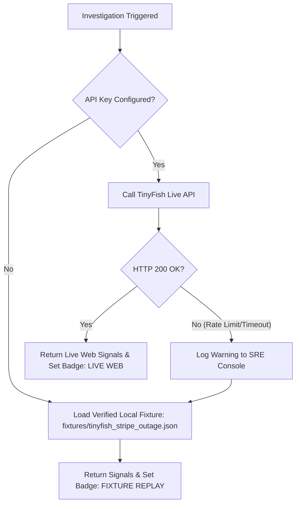

# SentinelTwin — External Integration Specification (INTEGRATION_SPEC)

**Document ID:** INT-001  
**Project:** SentinelTwin  
**External Services:** TinyFish AI Platform & Anthropic Claude API  
**Version:** 1.0.0  

---

## 1. TinyFish Platform Integration Architecture

TinyFish is the core external web intelligence engine for SentinelTwin. It replaces brittle manual scraping scripts with managed AI web capabilities.

### 1.1 Credentials & Security
- **Environment Variable:** `TINYFISH_API_KEY`
- **Header:** `X-API-Key: <TINYFISH_API_KEY>`
- **Security Rule:** Stored strictly server-side in the backend environment. Never injected into Vite frontend builds, client headers, or client bundle assets.

---

## 2. TinyFish API Endpoint Contracts

### 2.1 TinySearch (Web Index Search API)
- **Role:** Real-time discovery of breaking incident signals, developer advisories, news articles, and outage reports before official status pages update.
- **Protocol:** HTTP GET
- **Endpoint URL:** `https://api.search.tinyfish.ai`
- **Official Python SDK:** `client.search.query(query="...", location="US", language="en")`

#### Request Format (cURL)
```bash
curl -X GET "https://api.search.tinyfish.ai?query=Stripe+status+outage+degradation&location=US&language=en" \
  -H "X-API-Key: $TINYFISH_API_KEY" \
  -H "Accept: application/json"
```

#### Documented Response Schema
```json
{
  "query": "Stripe status outage degradation",
  "total_results": 12,
  "results": [
    {
      "title": "Stripe Status - Elevated API 500 Errors",
      "url": "https://status.stripe.com/incidents/2026-10-18-api-errors",
      "snippet": "We are experiencing elevated error rates affecting payment creation and tokenization API calls across us-east regions.",
      "published_date": "2026-10-18T08:45:00Z",
      "rank": 1
    },
    {
      "title": "Developers report payment failures across Stripe checkout",
      "url": "https://techcrunch.com/2026/10/18/stripe-payment-glitch-reports",
      "snippet": "E-commerce merchants report sudden surge in failed card transactions starting at 08:30 UTC.",
      "published_date": "2026-10-18T08:52:10Z",
      "rank": 2
    }
  ]
}
```

---

### 2.2 TinyFetch (Headless Chromium Clean Extraction API)
- **Role:** Navigates to target status pages or advisory URLs, executes JavaScript/SPAs via Chromium fleet, strips cookie banners and boilerplate, and returns clean Markdown.
- **Protocol:** HTTP POST
- **Endpoint URL:** `https://api.fetch.tinyfish.ai`
- **Official Python SDK:** `client.fetch.get_contents(urls=["https://..."])`

#### Request Format (cURL)
```bash
curl -X POST "https://api.fetch.tinyfish.ai" \
  -H "X-API-Key: $TINYFISH_API_KEY" \
  -H "Content-Type: application/json" \
  -d '{
    "urls": ["https://status.stripe.com"]
  }'
```

#### Documented Response Schema
```json
{
  "results": [
    {
      "url": "https://status.stripe.com",
      "title": "Stripe System Status",
      "status_code": 200,
      "text": "# Stripe System Status\n\n**Current Status:** Degraded Performance\n\n### Active Incidents\n- **Elevated API Errors (Identified):** We have identified an issue with a database cluster causing elevated 500 errors on `v1/charges`.\n\n### Component Status\n- Stripe API: Degraded\n- Webhooks: Operational\n- Dashboard: Operational",
      "html": "<html>...</html>"
    }
  ],
  "errors": []
}
```

---

### 2.3 TinyAgent (Goal-Oriented Web Agent API)
- **Role:** Autonomous navigation for complex incident portals requiring interactive dropdown selection or pagination.
- **Protocol:** HTTP POST
- **Official Python SDK:** `client.agent.run(goal="...", url="https://...")`
- **Usage Strategy for Hackathon:** Secondary integration due to execution latency ($15\text{--}30\text{s}$). Primary pipeline prioritizes TinySearch + TinyFetch ($< 3\text{s}$).

---

## 3. Resilience, Rate Limits & Fallback Strategy

### 3.1 Rate Limits & Error Handling
- **Search Rate Limits:** 10 requests / second.
- **Fetch Concurrency:** Up to 10 URLs per batch request.
- **Timeout Policy:** 10s total timeout, 5s connect timeout via `httpx.AsyncClient`.
- **Retry Policy:** 2 exponential backoff retries on HTTP 429 or 503 before triggering fixture fallback.

### 3.2 Deterministic Fixture Fallback Pattern
To guarantee an infallible 3-minute hackathon presentation, SentinelTwin implements the **Dual-Mode Adapter Pattern**:



---

## 4. Anthropic Claude API Integration

### 4.1 Specification
- **SDK:** `anthropic` (Python SDK v0.28+)
- **Model:** `claude-3-5-sonnet-20241022`
- **Environment Variable:** `ANTHROPIC_API_KEY`
- **Prompt Safety Guardrail:** All unstructured external web text is placed inside `<untrusted_web_evidence>` XML tags with explicit instructions forbidding prompt injection override.

### 4.2 Fallback Generator
If `ANTHROPIC_API_KEY` is not provided, SentinelTwin activates `DeterministicTemplateReporter`, which formats verified evidence and simulation metrics into the identical Markdown layout without calling an external LLM.
