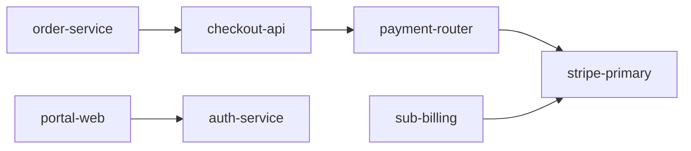

# SentinelTwin — Simulation Model (SIMULATION_MODEL)

**Project:** SentinelTwin (AZINHACK '26)
**Version:** 1.2.0 (verified against `DigitalTwinEngine` source and live API output)
**Reference stack:** PayNest fintech (fictional)

> **Supersedes v1.0 and v1.1.** Earlier versions described a 12-node graph, a Cascade Impact Score of
> 4.85, 18,400 users at risk and a 93.5% reduction. The implemented engine produces none of these.
> This version describes what the code does. Values marked **(inferred)** come from API output rather
> than from a visible seed file.

---

## 1. Honesty rules

The simulator is a **scenario model** over a configured dependency graph. It does not predict real
outages and does not read real telemetry.

| Class | Meaning | Examples here |
| :--- | :--- | :--- |
| REAL | Retrieved from the web with source and timestamp | TinyFish evidence items |
| COMPUTED | Deterministic output of the model | Blast radius, weighted impact score, deltas |
| SIMULATED | Assumed input or parameter | Node weights, node user counts, the 10,000-user population, the error-rate factor, "sub-billing is not migrated" |

API responses carry `provenance: COMPUTED`. Because the inputs are simulated, the UI should describe
results as **"computed from simulated inputs"**.

---

## 2. Graph semantics

- Directed graph. Edge `A -> B` means **A depends on B**.
- If B fails, impact flows to A and to everything that depends on A (descendants in the reversed graph).
- The graph must be a DAG. The engine rejects dangling edges, self-loops and cycles
  (`GraphInvalidException`).
- `criticality` is stored on each node but is **not used in any formula**. It is display metadata.

### 2.1 Reference graph (8 nodes, 5 edges)

| Node ID | Name | Category | Criticality |
| :--- | :--- | :--- | :--- |
| `stripe-primary` | Stripe Primary Gateway | PAYMENT_GATEWAY | MISSION_CRITICAL |
| `razorpay-backup` | Razorpay Backup Gateway | PAYMENT_GATEWAY | HIGH |
| `payment-router` | Payment Routing Service | API_BACKEND | HIGH |
| `checkout-api` | Checkout API Service | API_BACKEND | MISSION_CRITICAL |
| `order-service` | Order Processing Engine | API_BACKEND | HIGH |
| `sub-billing` | Subscription Billing Worker | API_BACKEND | MEDIUM |
| `auth-service` | Customer Authentication | AUTH_PROVIDER | HIGH |
| `portal-web` | PayNest Web Portal | FRONTEND_CLIENT | MEDIUM |

| Source (depends on) | Target (dependency) |
| :--- | :--- |
| `payment-router` | `stripe-primary` |
| `checkout-api` | `payment-router` |
| `order-service` | `checkout-api` |
| `sub-billing` | `stripe-primary` |
| `portal-web` | `auth-service` |



`razorpay-backup` has no dependents in the base graph. `auth-service` and `portal-web` are not
affected by a Stripe failure.

---

## 3. Propagation algorithm (`propagate_failure`)

Inputs: `failed_node_id`, `severity_factor` (default 1.0), `error_rate_factor` (default 0.5753564).

1. Validate the DAG. Reject unknown node IDs.
2. `descendants` = all nodes reachable from the failed node in the reversed graph.
3. Root contribution: `weight(root) * severity_factor`.
4. For each descendant `d`, with `h` = hops on the shortest path from the root:
   - `attenuation(d) = (1 / (1 + 0.1 * (h - 1))) * severity_factor`
   - `contribution(d) = weight(d) * attenuation(d)`
5. Weighted impact score `W` = root contribution + sum of descendant contributions.
6. Users at risk = `baseline_users(root)` + sum of `baseline_users(d)` over descendants.
7. Users at risk % = `users_at_risk / total_baseline_users * 100` (half-up, 1 decimal).
8. Transaction failure rate % = `users_at_risk * error_rate_factor / total_baseline_users * 100`.
9. Transaction success rate % = `100 - failure rate` (using the rounded failure rate).
10. Affected services = number of descendants + 1 (the root counts).

All rounding is half-up (`round_half_up`).

---

## 4. Reference results (root = `stripe-primary`, severity 1.0)

### 4.1 Per-node inputs and outputs

| Node | Hops | Attenuation | Weight (inferred) | Contribution | Users (`baseline_users`) |
| :--- | :--- | :--- | :--- | :--- | :--- |
| `stripe-primary` (root) | 0 | n/a | 10.0 | 10.0 | 0 |
| `payment-router` | 1 | 1.0 | 6.0 | 6.0 | 0 |
| `sub-billing` | 1 | 1.0 | 0.2 | 0.2 | 200 |
| `checkout-api` | 2 | 0.9091 | 5.5 | 5.0 | 1,200 |
| `order-service` | 3 | 0.8333 | 2.4 | 2.0 | 564 |
| **Total** | | | | **W = 23.2** | **1,964** |

Weights for `checkout-api` and `order-service` are the contribution divided by attenuation. Confirm
all weights and user counts in the seed data file. These are **SIMULATED** inputs.

### 4.2 Population and rates

- `total_baseline_users` defaults to 10,000 (**SIMULATED**). 1,964 / 10,000 = 19.6%.
- Failure rate: 1,964 × 0.5753564 / 10,000 × 100 = 11.3%. Success rate = 88.7%.
- The `error_rate_factor` 0.5753564 is a hand-set parameter. It means "about 57.5% of at-risk users
  fail a transaction". It is an **assumption**, not a measured value. Its precision suggests it was
  tuned to reproduce 11.3%. Present it as an assumption.

### 4.3 Severity handling

`severity_factor` scales the weighted impact score only. It does **not** change users at risk or the
transaction failure rate, so a severity slider will move `W` but not the user metrics.

---

## 5. Recovery scenario (`simulate_mitigation`)

Inputs: `failed_node_id`, optional `fallback_node_id` (defaults to the node's `fallback_node_id`).

1. Compute the baseline with `propagate_failure`.
2. Copy the graph.
3. For every direct dependent of the failed node **except `sub-billing`**: remove the edge to the
   failed node and add an edge to the fallback node.
4. Recompute descendants of the failed node on the copy. Add up `W` and users the same way.
5. Compute deltas.

`sub-billing` is excluded by a hard-coded name check in the engine. It represents the
**SIMULATED ASSUMPTION** that recurring-billing webhooks cannot fail over automatically. The failed
gateway stays failed, so it still counts as an affected service.

### 5.1 Baseline vs mitigated

| Metric | Baseline | Mitigated | Change |
| :--- | :--- | :--- | :--- |
| Affected services | 5 | 2 (`stripe-primary`, `sub-billing`) | 3 restored (60%) |
| Weighted impact score | 23.2 | 10.2 (10.0 + 0.2) | −56.0% |
| Users at risk | 1,964 (19.6%) | 200 (2.0%) | −89.8%, 1,764 restored |
| Transaction success rate | 88.7% | 98.8% | +10.1 percentage points |
| Transaction failure rate | 11.3% | 1.2% | −10.1 percentage points |

User risk reduction = `(users_baseline − users_mitigated) / users_baseline * 100`.
Services restored = baseline affected services − mitigated affected services.

> The README states "1 service" and "80% recovery" for the mitigated case. The engine returns 2
> services and 3 restored (60%). Update the README.

---

## 6. Ranked action plan

The plan is a **fixed template with two entries**. Only the P0 `expected_impact` text uses computed
numbers (users restored, reduction percentage). The P1 entry and the ordering do not depend on the
graph. It is not a computed ranking.

| Priority | Action | Target |
| :--- | :--- | :--- |
| P0 | Enable standby gateway failover route | fallback node |
| P1 | Pause recurring subscription billing retries | `sub-billing` |

Both entries require human approval. The `runbook_command` values (`aws ssm ...`, `kubectl ...`) are
illustrative text for a fictional document and namespace. SentinelTwin never runs them.

---

## 7. Known issues in the engine

1. **Non-deterministic list order.** `affected_node_ids` and `remaining_affected_node_ids` use
   `[root] + list(set)`, so order can change between runs. Use `sorted(...)`.
2. **Division by zero.** The user reduction percentage divides by baseline users at risk. A scenario
   with zero users at risk raises `ZeroDivisionError`. Guard it. `total_baseline_users = 0` has the
   same problem.
3. **Hard-coded `sub-billing`.** Move this to a node attribute such as `failover_capable: false` so
   the assumption is visible in the data.
4. **Severity does not affect users or failure rate** (see 4.3).
5. **Static ranked plan** (see section 6).
6. **Unvalidated IDs in runbook text.** Node IDs are inserted into command strings. Validate IDs
   (for example `^[a-z0-9-]+$`) when nodes are added.
7. **Fallback checks.** The fallback is not checked for equality with the failed node or for creating
   a cycle after rewiring.

---

## 8. Limitations

- Weights, user counts, the population and the error-rate factor are invented for the demo. Results
  show how the model behaves, not what a real PayNest would lose.
- Users are summed per node with no de-duplication. Real users can span several services.
- The backup gateway is assumed healthy and unlimited. Capacity, latency and retries are not modeled.
- Evidence from TinyFish selects which node to fail. It does not change the arithmetic.

---

## 9. Reproduce the reference numbers (PowerShell)

```powershell
$b1 = '{"root_cause_node_id":"stripe-primary","severity_factor":1.0}'
Invoke-RestMethod -Method Post -Uri http://localhost:8000/api/simulation/propagate -ContentType "application/json" -Body $b1 | ConvertTo-Json -Depth 10

$b2 = '{"failed_node_id":"stripe-primary","mitigation_action":"FAILOVER_BACKUP","target_fallback_id":"razorpay-backup"}'
Invoke-RestMethod -Method Post -Uri http://localhost:8000/api/simulation/mitigate -ContentType "application/json" -Body $b2 | ConvertTo-Json -Depth 10
```

Automated check: `python -m pytest backend/tests/ -v` (see `test_golden_values_reproduction`).