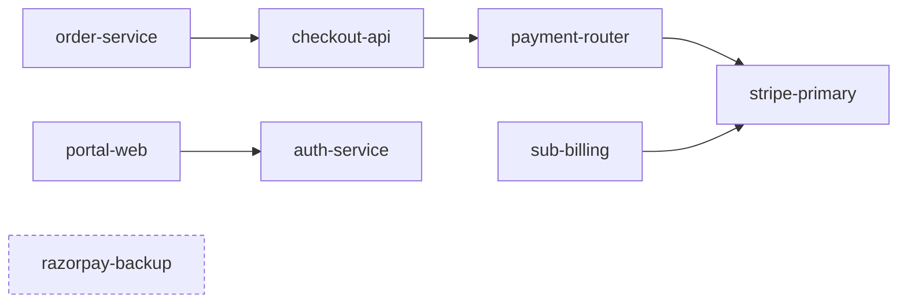

# SentinelTwin — Simulation Model (SIMULATION_MODEL)

**Project:** SentinelTwin (AZINHACK '26)
**Version:** 1.1.0 (aligned to the running backend)
**Reference stack:** PayNest fintech (fictional)

> **Supersedes v1.0.** The earlier version described a 12-node graph, a Cascade Impact Score of 4.85,
> 18,400 users at risk and a 93.5% reduction. None of those values are produced by the implemented
> backend, and they could not be derived from the formulas in v1.0. This version documents what
> `POST /api/simulation/propagate` and `POST /api/simulation/mitigate` actually return.
> Items that could not be confirmed from API output are marked **VERIFY IN CODE**.

---

## 1. Purpose and honesty rules

The simulator is a **scenario model** over a configured dependency graph. It does not predict real
outages and does not read real telemetry.

| Class | Meaning | Examples here |
| :--- | :--- | :--- |
| REAL | Retrieved from the web with source and timestamp | Evidence items from TinyFish |
| COMPUTED | Deterministic output of the model | Blast radius, weighted impact score, deltas |
| SIMULATED | Assumed input to the model | Per-node weights, user counts, population, "sub-billing is not migrated" |

API responses are tagged `provenance: COMPUTED`. Because the inputs are simulated, the UI should
describe results as **"computed from simulated inputs"**, never as measured production figures.

---

## 2. Graph semantics

- Graph `G = (V, E)`, directed. Edge `A -> B` means **A depends on B**.
- If B fails, impact flows against the edge to A, then to everything that depends on A.
- Implementation idea: take descendants of the failed node in the **reversed** graph.
- The graph must be acyclic. The backend rejects cycles, self-loops and edges to unknown nodes
  (covered by `test_reject_cycles_graph_invalid`, `test_reject_self_loop`, `test_reject_dangling_edge`).

### 2.1 Reference graph (from `GET /api/environment`)

| Node ID | Name | Category | Criticality |
| :--- | :--- | :--- | :--- |
| `stripe-primary` | Stripe Primary Gateway | PAYMENT_GATEWAY | MISSION_CRITICAL |
| `razorpay-backup` | Razorpay Backup Gateway | PAYMENT_GATEWAY | HIGH |
| `payment-router` | Payment Routing Service | API_BACKEND | HIGH |
| `checkout-api` | Checkout API Service | API_BACKEND | MISSION_CRITICAL |
| `order-service` | Order Processing Engine | API_BACKEND | HIGH |
| `sub-billing` | Subscription Billing Worker | API_BACKEND | MEDIUM |
| `auth-service` | Customer Authentication | AUTH_PROVIDER | HIGH |
| `portal-web` | PayNest Web Portal | FRONTEND_CLIENT | MEDIUM |

8 nodes, 5 edges:

| Source (depends on) | Target (dependency) |
| :--- | :--- |
| `payment-router` | `stripe-primary` |
| `checkout-api` | `payment-router` |
| `order-service` | `checkout-api` |
| `sub-billing` | `stripe-primary` |
| `portal-web` | `auth-service` |



`razorpay-backup` has no dependents in the base graph. It is used only by the failover scenario.
`auth-service` and `portal-web` are unaffected by a Stripe failure.

---

## 3. Failure propagation

Given a failed root node:

1. Find all nodes that transitively depend on it (descendants in the reversed graph).
2. Blast radius = root + those descendants.
3. For each descendant, record the shortest path (`propagation_paths`) and hop count `h`.
4. Attenuation per node: `attenuation = 1 / (1 + 0.1 * (h - 1))`.

Verified against API output:

| Node | Hops | Attenuation reported | Formula result |
| :--- | :--- | :--- | :--- |
| `payment-router` | 1 | 1.0 | 1.0 |
| `sub-billing` | 1 | 1.0 | 1.0 |
| `checkout-api` | 2 | 0.9091 | 0.9091 |
| `order-service` | 3 | 0.8333 | 0.8333 |

---

## 4. Metrics (observed from `/api/simulation/propagate`, root = `stripe-primary`, severity 1.0)

### 4.1 Weighted impact score (W)

Observed: **W = 23.2**, equal to the plain sum of per-node weight contributions:

| Node | weight_contribution |
| :--- | :--- |
| `stripe-primary` (root) | 10.0 *(inferred: not in the response; 23.2 − 13.2)* |
| `payment-router` | 6.0 |
| `checkout-api` | 5.0 |
| `order-service` | 2.0 |
| `sub-billing` | 0.2 |
| **Total** | **23.2** |

Notes:
- Contributions are **not** derived from the criticality levels (`payment-router` is HIGH but weighs
  more than MISSION_CRITICAL `checkout-api`). They behave like per-node business weights, which are
  **SIMULATED** inputs.
- The response also reports `attenuation`, but the sum above matches without applying it.
  **VERIFY IN CODE** whether attenuation is folded into the contributions or used elsewhere.
- The root weight of 10.0 is inferred from the arithmetic. **VERIFY IN CODE.**

### 4.2 Users at risk

Observed: sum of per-node `users_at_risk` over affected nodes:

| Node | users_at_risk |
| :--- | :--- |
| `checkout-api` | 1,200 |
| `order-service` | 564 |
| `payment-router` | 0 |
| `sub-billing` | 200 |
| **Total** | **1,964** |

- Percentage reported: **19.6%**. This implies a simulated population of 10,000 users
  (1,964 / 10,000). **VERIFY IN CODE.**
- How each node's user count is derived (for example 564 for `order-service`) is not visible in the
  API output. **VERIFY IN CODE.**

### 4.3 Transaction failure and success rate

Observed: failure 11.3%, success 88.7% (baseline); failure 1.2%, success 98.8% (mitigated).
The formula is **not recoverable from the output**. **VERIFY IN CODE** and document it here.
Treat these as **SIMULATED** until the formula is documented.

### 4.4 Rounding

Values are rounded half-up (`test_round_half_up`).

---

## 5. Recovery scenario: failover to Razorpay

`POST /api/simulation/mitigate` with `failed_node_id = stripe-primary`,
`target_fallback_id = razorpay-backup`.

Modeled behavior:
- Traffic that depended on Stripe through `payment-router` is redirected to `razorpay-backup`.
  `payment-router`, `checkout-api` and `order-service` recover.
- `sub-billing` is modeled as **not migrated** (for example, recurring-billing webhooks still point at
  Stripe). This is a **SIMULATED ASSUMPTION** and must be shown as such in the UI.
- `stripe-primary` itself remains failed, so it still counts as affected.

### 5.1 Baseline vs mitigated

| Metric | Baseline (Stripe down) | Mitigated (failover) | Change |
| :--- | :--- | :--- | :--- |
| Affected services | 5 | 2 (`stripe-primary`, `sub-billing`) | 3 restored (60%) |
| Weighted impact score | 23.2 | 10.2 (= 10.0 + 0.2) | −56.0% |
| Users at risk | 1,964 (19.6%) | 200 (2.0%) | −89.8% (1,764 restored) |
| Transaction success rate | 88.7% | 98.8% | +10.1 percentage points |
| Transaction failure rate | 11.3% | 1.2% | −10.1 percentage points |

Delta formulas (verified against output):
- Weighted impact reduction = (23.2 − 10.2) / 23.2 = 56.0%
- User risk reduction = (1,964 − 200) / 1,964 = 89.8%
- Services restored = 5 − 2 = 3

> **Correction needed in README:** it lists the mitigated impacted services as "1 service" with an
> 80% recovery. The API reports 2 affected services (the failed gateway still counts) and
> `services_restored = 3`, which is a 60% reduction.

---

## 6. Ranked action plan

Returned by `/api/simulation/mitigate` as rule-based items. Both require human approval.

| Priority | Action | Target | Expected impact (simulated) |
| :--- | :--- | :--- | :--- |
| P0 | Enable standby gateway failover route | `razorpay-backup` | 1,764 users restored (89.8%) |
| P1 | Pause recurring subscription billing retries | `sub-billing` | Avoids a webhook retry storm |

The `runbook_command` strings (`aws ssm ...`, `kubectl ...`) are **illustrative** and reference a
fictional document and namespace. The UI must label them "illustrative example, not executed".
SentinelTwin never runs them.

---

## 7. Limitations

- Weights, user counts, population and the "sub-billing not migrated" assumption are invented for the
  demo. Results show how the model behaves, not what a real PayNest would lose.
- The model assumes a failed provider is fully unavailable at severity 1.0 and does not model partial
  capacity of the backup gateway.
- Fallback capacity, retries and latency are not modeled.
- Evidence from TinyFish informs which node to fail; it does not change the arithmetic.

---

## 8. Open items to confirm in the code

1. Root node weight (inferred 10.0) and where per-node weights are defined.
2. Whether attenuation is applied to weights or user counts.
3. Derivation of per-node `users_at_risk` and the 10,000 population.
4. Formula for transaction failure rate.
5. How `sub-billing` is flagged as not migrated.
6. Severity handling when `severity_factor` is below 1.0.

---

## 9. Reproduce the reference numbers (PowerShell)

```powershell
$b1 = '{"root_cause_node_id":"stripe-primary","severity_factor":1.0}'
Invoke-RestMethod -Method Post -Uri http://localhost:8000/api/simulation/propagate -ContentType "application/json" -Body $b1 | ConvertTo-Json -Depth 10

$b2 = '{"failed_node_id":"stripe-primary","mitigation_action":"FAILOVER_BACKUP","target_fallback_id":"razorpay-backup"}'
Invoke-RestMethod -Method Post -Uri http://localhost:8000/api/simulation/mitigate -ContentType "application/json" -Body $b2 | ConvertTo-Json -Depth 10
```

Automated check: `python -m pytest backend/tests/ -v` (see `test_golden_values_reproduction`).